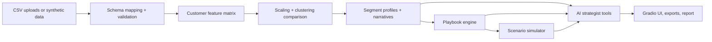

# MOSAIC AI — Customer Intelligence Studio
Every customer is a pattern. Find the ones that matter.

## Overview and business problem
Broad demographic segments send similar messages to customers who behave very differently. MOSAIC AI discovers behavioural segments from transaction and interaction data, explains them with measurable evidence, proposes differentiated playbooks and lets marketers compare hypothetical campaign outcomes. Bundled data is **fictional synthetic data**.

## Features
Schema mapping and validation, RFM plus engagement features, K-Means / Agglomerative / Gaussian Mixture comparison with stability checks, deterministic interpretation with optional validated LLM narratives, segment explorer and comparison, editable playbooks, campaign scenario simulator, customer lookup, tool-grounded AI strategist, quality and bias audit, exports and executive report.

## Architecture and data flow


## Technology stack
Python, Gradio, Plotly, scikit-learn, SciPy, pandas, NumPy.

## Installation and local launch
```
pip install -r requirements.txt
python app.py
```
Google Colab: paste `app.py` into one cell and run it.

## Data, upload and mapping
See `docs/data_dictionary.md`. Upload transactions (required), interactions and customers (optional). If auto-detection fails, enter mappings such as `customer_id=cust, transaction_value=amount`.

## Methodology
See `docs/methodology.md`. Segment IDs are ordered by net spend per run and are not stable across retrains.

## LLM configuration
Optional. Choose Anthropic or an OpenAI-compatible endpoint and enter a key in the app (session only), or set `ANTHROPIC_API_KEY` / `OPENAI_API_KEY`. Without a key a deterministic, transparent fallback is used. Only aggregated statistics are sent; the LLM never assigns segments.

## Tests
```
pip install pytest
pytest tests
```

## Screenshots
Add your own to `screenshots/` (see its README). None are included.

## Privacy, limitations and responsible AI
Use pseudonymous IDs (the app can hash IDs with a session salt). Never commit real customer data or API keys. Demographics are for auditing only. See `docs/limitations.md`.

## Deployment
Run locally, in Colab, or deploy `app.py` as a Hugging Face Space (SDK: Gradio) with your own credentials.

## Future improvements
Campaign-response data for calibrated simulations, uplift modelling, scheduled retraining with profile matching.
